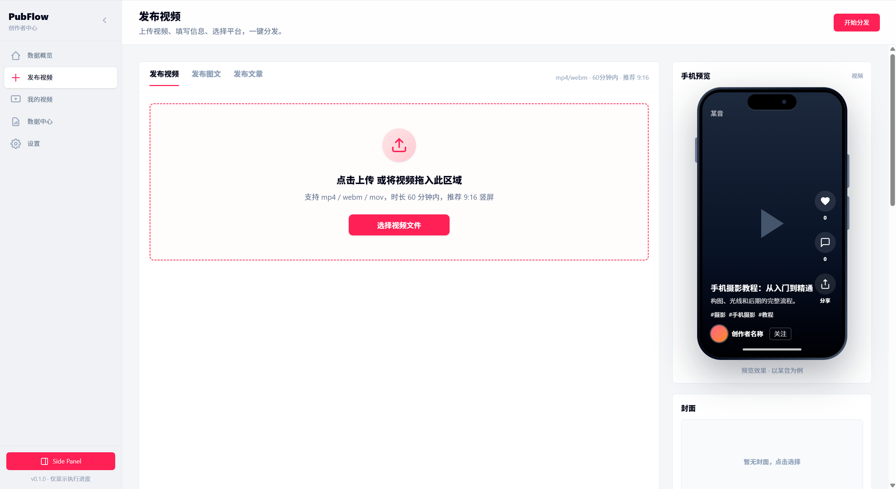
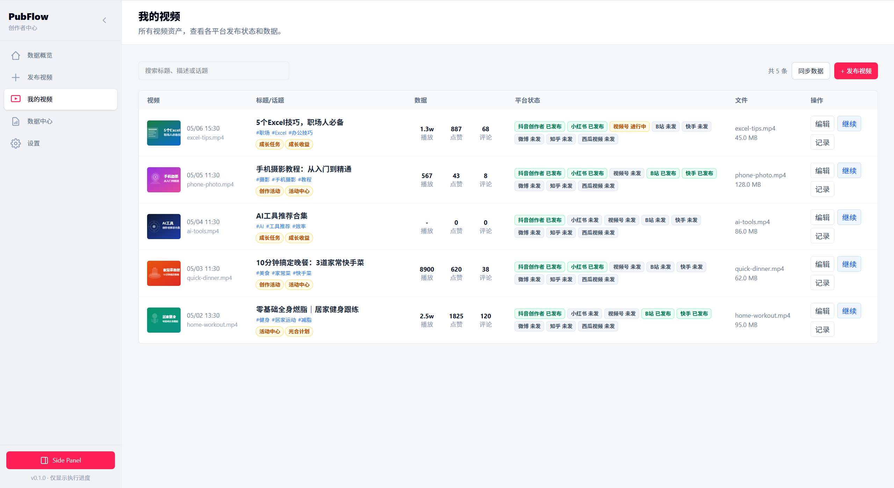
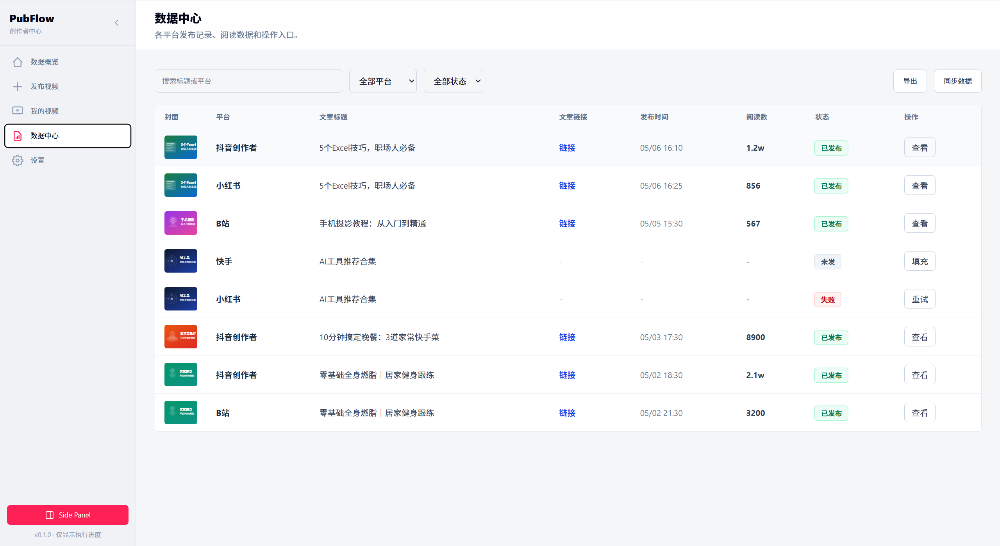
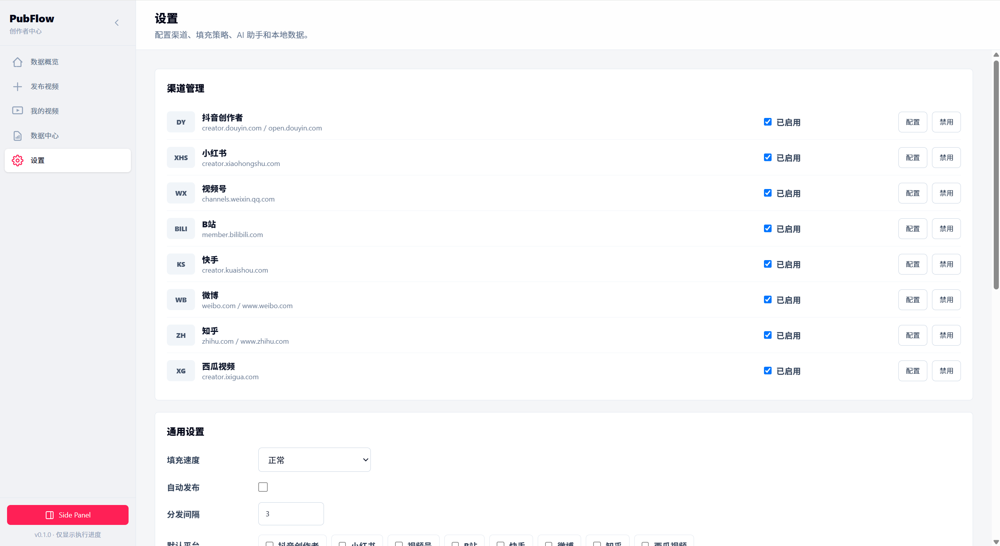

# PubFlow 多平台内容发布助手

Chrome MV3 + WXT + Vue 3 + TypeScript + Tailwind CSS。

一站式多平台内容分发工具，支持**视频、图文、文章**三种内容类型，覆盖抖音、小红书、B站、快手、微博、知乎、视频号七大平台。内置 AI 润色与排版，Markdown 编辑器实时预览，拟人化自动填充发布页。

## 界面预览

### 首页概览


### 发布页



### 我的视频



### 数据中心



### 设置



## 核心功能

### 三种内容类型

| 类型 | 说明 | 支持平台 |
|------|------|----------|
| **视频** | 上传 mp4/webm 视频 + 封面，填写标题描述话题 | 抖音、小红书、B站、快手、微博、知乎、视频号 |
| **图文** | 上传多张图片 + 封面，填写标题描述话题 | 抖音、小红书、B站、快手、微博 |
| **文章** | Markdown 编辑器，支持粘贴图片，实时渲染预览 | 抖音、小红书、B站、微博、知乎 |

### AI 辅助写作

文章编辑器内置两个 AI 功能（需在设置中配置 AI 提供商的 API Key）：

- **AI 润色**：优化用词和表达，提升文章质感，保持原文观点和结构不变
- **AI 排版**：优化 Markdown 格式、标题层级、列表和段落节奏，不修改文字内容

两个功能均支持**流式输出**，实时渲染 AI 返回结果，并提供原文与 AI 结果的**双栏对比视图**，确认后一键应用。

### 发布流程

1. Dashboard 填写内容，选择目标平台
2. 点击"开始分发"，自动打开各平台发布页
3. 先检测登录、弹窗、草稿恢复等阻挡，用户手动处理
4. 点击"继续填充"，插件自动填入标题、描述、话题
5. 视频/图文模式：自动上传文件并填充
6. 文章模式：自动填充正文到富文本编辑器
7. 用户检查后手动点击发布

### 拟人化策略

- 逐字输入模拟真人打字节奏
- 随机延迟和抖动
- 滚动到可视区域后再操作
- 检测页面可见性，后台标签页等待
- 各平台独立的容错和重试机制

## 产品结构

- **Dashboard**：完整工作台，用于填写内容、选择平台、管理视频记录、配置设置、启动分发。
- **Side Panel**：执行监控台，用于查看平台状态、打开平台页、继续填充、跳过平台。
- **Content Script**：注入各平台发布页，负责检测阻挡、拟人填充、上传文件、填充文章正文。
- **Background**：任务中控，负责打开平台 tab、跨 tab 通信和任务状态同步。

## 安装

从 [Release](https://github.com/Chaoleme/PubFlow/releases) 下载最新版本：

- **CRX**：将 `.crx` 文件拖拽到 `chrome://extensions/` 页面即可安装
- **ZIP**：解压后在 `chrome://extensions/` 开启「开发者模式」→「加载已解压的扩展」→ 选择解压目录

## 使用流程

1. 点击扩展图标打开 Dashboard
2. 填写标题、描述、话题，选择目标平台
3. 点击「开始分发」，插件会打开各平台发布页
4. 在平台页面手动处理登录、弹窗等阻挡
5. 回到 Dashboard 或 Side Panel，点击「继续填充」
6. 检查内容后手动点击发布

## 平台适配

| 平台 | 视频 | 图文 | 文章 | 自动切前台 | 特殊说明 |
|------|:----:|:----:|:----:|:----------:|----------|
| 抖音 | ✅ | ✅ | ✅ | 是 | 检测页面可见性，后台不渲染上传组件 |
| 小红书 | ✅ | ✅ | ✅ | 是 | 同上 |
| B站 | ✅ | ✅ | ✅ | 否 | 文章编辑器在同源 iframe 中 |
| 快手 | ✅ | ✅ | — | 是 | 后台标签页延迟渲染 |
| 微博 | ✅ | ✅ | ✅ | 否 | 文章使用 TipTap 编辑器 |
| 知乎 | ✅ | — | ✅ | 是 | 文章使用 Draft.js，需 CDP 可信点击 |
| 视频号 | ✅ | — | — | 是 | Shadow DOM 需要活跃上下文 |

---

## 项目结构

> 以下内容面向开发者。

这是 **一个 WXT 扩展项目**，不是两个 npm 项目。

```text
entrypoints/
  dashboard/
    App.vue                           # Dashboard 主布局
    views/
      PublishView.vue                 # 发布页（视频/图文/文章切换）
      DashboardView.vue               # 数据概览
      VideosView.vue                  # 我的视频
      RecordsView.vue                 # 发布记录
      SettingsView.vue                # 设置
    components/
      PublishVideo.vue                # 视频上传组件
      PublishImage.vue                # 图文上传组件
      PublishArticle.vue              # 文章 Markdown 编辑器 + AI 按钮
      AiDiffView.vue                  # AI 润色/排版对比视图
      PhonePreview.vue                # 手机预览（视频/图文/文章三种模式）
      ...
  sidepanel/
    App.vue                           # Side Panel 进度监控
  background.ts                       # 任务中控：跨 tab 通信、状态同步
  content.ts                          # 平台识别、状态上报、调度分发

src/
  ai/
    streamChat.ts                     # SSE 流式聊天（OpenAI 兼容 API）
    prompts.ts                        # AI 润色/排版系统提示词
  content/
    dom.ts                            # DOM 查询、等待、滚动
    fieldFiller.ts                    # 文本填充（粘贴、逐字输入、contentEditable）
    articleBodyFiller.ts              # 文章正文填充（Tiptap/ProseMirror/Draft.js）
    imageUploader.ts                  # 图片上传
    videoUploader.ts                  # 视频/封面上传
    publishSteps.ts                   # 共享发布步骤（声明、定时、可见性）
    blockerDetector.ts                # 登录/弹窗/加载阻挡检测
  features/
    ai/
      useArticleAI.ts                 # AI 润色/排版 Vue composable
    distribution/                     # 分发流程
    library/                          # 视频库管理
    publish/                          # 发布草稿管理
    settings/                         # 设置管理
    tasks/                            # 任务状态管理
    workspace/                        # 工作区管理
  platforms/
    index.ts                          # 聚合导出 PLATFORM_CONFIGS / PLATFORM_ORDER
    flows.ts                          # 平台 content handler 调度表
    types.ts                          # 平台适配相关类型
    shared.ts                         # 平台共用构建逻辑
    campaigns.ts                      # 聚合导出平台活动数据
    douyin/                           # 抖音
    xiaohongshu/                      # 小红书
    weixinChannels/                   # 视频号
    bilibili/                         # B站
    kuaishou/                         # 快手
    weibo/                            # 微博
    zhihu/                            # 知乎
  storage/                            # 存储层（draft、settings、workspace、library）
  domain/                             # 业务领域逻辑
  types.ts                            # 全局类型定义
```

每个平台目录下：

- `selectors.ts` — 发布页选择器与上传配置
- `content.ts` — 平台填充逻辑（视频/图文/文章）
- `campaigns.ts` — 活动/收益入口

新增平台时，在 `src/platforms/index.ts`、`campaigns.ts` 和 `flows.ts` 聚合即可。

## 技术亮点

### 文章正文自动填充

支持三种主流富文本编辑器引擎：

| 平台 | 编辑器引擎 | 填充方式 |
|------|-----------|----------|
| 抖音 | Tiptap (ProseMirror) | `editor.commands.setContent(html)` |
| 小红书 | Tiptap (ProseMirror) | `editor.commands.setContent(html)` |
| 微博 | TipTap (ProseMirror) | `editor.commands.setContent(html)` |
| B站 | ProseMirror | `view.dispatch(view.state.tr)` |
| 知乎 | Draft.js | `document.execCommand('insertText')` |

Markdown 内容会先转换为 HTML，然后注入到对应的富文本编辑器中。

### AI 流式输出

使用 SSE（Server-Sent Events）协议，通过 `fetch` + `ReadableStream` 实现流式接收。支持所有 OpenAI 兼容 API（DeepSeek、OpenAI、通义千问、SiliconFlow 等）。Vue 响应式数据驱动 `markstream-vue` 做打字机流式渲染。

---

## 开发协作

### 安装依赖

```bash
cp .env.example .env
pnpm install
```

### 开发模式

```bash
pnpm dev
```

WXT 会自动构建扩展、打开独立 Chrome Profile、加载扩展。Vue 页面支持热更新；修改 `manifest`、`background`、`content script` 等扩展层代码后，需到 `chrome://extensions/` 点刷新按钮。

`.env` 可选配置：

- `PUBFLOW_CHROMIUM_PROFILE`：固定开发浏览器 Profile 路径，保留登录态和扩展数据
- `PUBFLOW_DEV_WORKSPACE_PATH`：预设开发工作区路径

### 生产构建

```bash
pnpm typecheck
pnpm build
```

构建产物在 `.output/chrome-mv3` 目录。

也可以用独立 Profile 手动测试稳定构建版。注意：开发时优先用 `pnpm dev`；下面这套只用于生产构建包验证。

```powershell
pnpm build

$chrome = “$env:ProgramFiles\Google\Chrome\Application\chrome.exe”
$ext = (Resolve-Path “.output\chrome-mv3”).Path
$profile = “$env:TEMP\pubflow-build-9222”

Start-Process $chrome -ArgumentList @(
  “--remote-debugging-port=9222”,
  “--remote-allow-origins=*”,
  “--user-data-dir=$profile”,
  “--disable-extensions-except=$ext”,
  “--load-extension=$ext”,
  “chrome://extensions/”
)
```

```shell
# Mac
open -na "Google Chrome" --args \
  --remote-debugging-port=9222 \
  '--remote-allow-origins=*' \
  --user-data-dir="$HOME/Downloads/PubFlow/chrome-profile-9222" \
  --no-first-run \
  --no-default-browser-check
```

如果新版 Chrome 环境不接受 `--load-extension`，就打开 `chrome://extensions/`，开启”开发者模式”，手动”加载已解压的扩展”，选择 `.output\chrome-mv3`。开发模式不受这个限制，因为 `pnpm dev` 由 WXT/web-ext 负责加载。

### 9222 端口浏览器启动检查

```powershell
Invoke-RestMethod http://127.0.0.1:9222/json/version
```

如果端口被占用：

```powershell
netstat -ano | findstr :9222
```

可打开的调试入口：

```text
http://127.0.0.1:9222/json/version
http://127.0.0.1:9222/json
```

### 开发调试流程

1. `pnpm dev` 启动开发模式，WXT 自动构建并加载扩展
2. 在 Dashboard 填标题、描述、话题，选择目标平台
3. 点击「开始分发」，插件会打开第一个平台发布页，但不会立即填充
4. 在平台页面手动处理登录、弹窗、草稿恢复、上传提示
5. 回到 Dashboard 或 Side Panel，点击对应平台的「继续填充」
6. 插件填入文本后，用户手动上传视频/封面并点击发布

### 数据持久化

采用"两层存储"：

- **本地工作区**：`pubflow-data.json`（草稿、设置、记录）、`projects/` 目录（项目素材）
- **浏览器存储**：工作区授权句柄、当前任务缓存、运行时状态

### 常用命令

```bash
pnpm dev          # 开发模式
pnpm typecheck    # 类型检查
pnpm build        # 生产构建
pnpm zip          # 打包发布
```

## 许可声明

本项目采用 **CC BY-NC-SA 4.0**（Creative Commons 署名-非商业性共享 4.0 国际协议）许可。

- 可自由使用、修改和分发，但**必须署名原作者**。
- **禁止商业用途**。
- 修改后的衍生作品**必须以相同协议开源**。
- 完整法律文本：[LICENSE](./LICENSE) | [在线全文](https://creativecommons.org/licenses/by-nc-sa/4.0/legalcode)

## 社区声明

本项目源自 [Linux.do](https://linux.do) 社区，感谢社区成员的支持与贡献。

## Sponsor

如果项目对你有帮助，请老王吃个菜夹馍（我不喝咖啡🐶）

| WeChat Pay | Alipay |
|:----------:|:------:|
|  |  |
