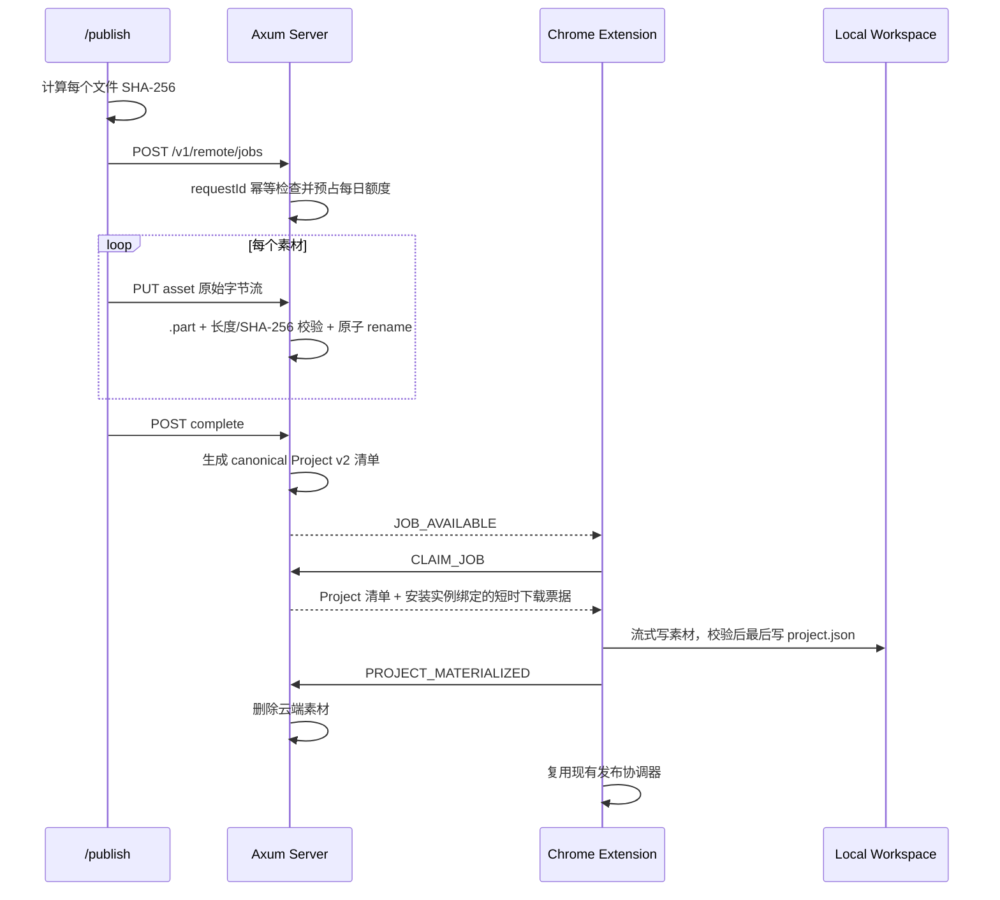

# PubFlow Pro 双通道远程发布架构

## 1. 最终结论

PubFlow 同时保留两条任务入口，但插件端只有一个发布执行器：

```mermaid
flowchart LR
    Script[用户脚本] -->|HTTP + 本地 Token| Native[Native 0.0.0.0:5190]
    LocalPage[局域网手机页面] -->|ECDH 登录 + HttpOnly Cookie| Native
    Page[/publish 网页] -->|HTTPS + HttpOnly Cookie| Server[公网 Axum 服务]
    Native -->|本机 WebSocket| Scheduler[插件双源协调器]
    Server -->|WSS + PFRP v1| Scheduler
    Scheduler -->|Native 优先，单任务锁| Coordinator[DistributionCoordinator]
    Coordinator --> Platforms[抖音 / 小红书 / 视频号等平台]
```

- **本地方案**：用户自行运行脚本，素材不经过公网，不限次数和流量。
- **公网方案**：任何浏览器均可打开 `/publish` 提交任务，默认每个 License 每天 3 次、总素材小于 104,857,600 字节（100 MiB）。
- **选择原则**：本地素材量大或自动化频繁时使用 Native；手机、异地设备或临时提交使用公网网页。
- **执行规则**：不打断正在发布的任务；插件空闲时先领取 Native 任务，再领取云端任务。

授权层级只有三种，不存在 `free`、`enterprise` 或未知层级回退：

| 层级 | 能力 |
| --- | --- |
| `basic` | 插件手动发布 |
| `plus` | Basic + Native、脚本和局域网页面 |
| `pro` | Plus + 公网网页和云端 PFRP WebSocket |

现有 License 数据已经是 `pro`，License 表不做层级迁移。订单、商品和批次显式保存 `basic / plus / pro`；服务端、插件和 Native 都按同一能力矩阵拒绝越权入口。

## 2. WebSocket 与私有协议的关系

WSS 只负责建立可穿越 NAT 的双向长连接。PFRP 是运行在 WSS 二进制帧内的应用协议，两者不是二选一。

PFRP v1 使用：

- `PFRP` 魔数、协议版本、帧类型和严格递增序号；
- X25519 ECDH 派生每次连接独立的临时双向密钥；
- AES-256-GCM 加密并认证每个消息；
- 客户端到服务端、服务端到客户端使用不同密钥；
- 连接认证复用现有 Lease、安装实例 ID、P-256 设备密钥和一次性 challenge；
- 激活码和网页 Cookie 都不会进入插件长连接。

`chrome.alarms` 每分钟只检查连接是否需要重建，不轮询任务。任务完成上传时服务端按 License 发送事件，对应 WSS 连接收到 `JOB_AVAILABLE`；插件空闲后主动发送 `CLAIM_JOB`。

## 3. 网页会话

网页不保存激活码。登录时激活码只用于查找 License，成功后服务端下发两个随机、不透明的 Cookie：

| Cookie | 生命周期 | 用途 |
| --- | ---: | --- |
| Access | 15 分钟 | 调用任务、额度和上传接口 |
| Refresh | 30 天不活动过期 | 轮换 Access 和 Refresh |

生产 Cookie 使用 `HttpOnly + Secure + SameSite=Strict`。开发环境可以通过配置关闭 `Secure`，以便使用本地 HTTP。License 到期早于 Cookie 到期时，以 License 到期时间为上限。每次重新使用激活码登录都会吊销该 License 之前的网页会话，因此默认只有一个长期网页会话。

登录接口独立按 IP 限速。激活码为 `PF-` 加 16 位 Base36 随机字符，约 83 bit 熵；安全性主要依赖随机性、限速、TLS 和会话轮换，不额外要求用户管理第二个长期密码。

## 4. 云端任务和素材



额度在任务首次创建成功时预占，任务失败或取消不退回，避免通过反复创建和取消绕过限制。`requestId` 在同一 License 内唯一，客户端重试不会重复扣额。

素材存储在服务端本地目录。未完成上传的任务和素材保留 72 小时；插件确认 `PROJECT_MATERIALIZED` 后立即删除素材；完成、失败或取消的任务元数据保留 30 天。后台每小时执行一次清理。

## 5. 主要接口

```text
POST /v1/remote/session/login
POST /v1/remote/session/refresh
POST /v1/remote/session/logout
GET  /v1/remote/session

POST /v1/remote/jobs
PUT  /v1/remote/jobs/{jobId}/assets/{assetId}
POST /v1/remote/jobs/{jobId}/complete
GET  /v1/remote/jobs
GET  /v1/remote/jobs/{jobId}
GET  /v1/remote/quota
POST /v1/remote/channel/test

GET  /v1/remote/extension/ws
GET  /v1/remote/assets/{assetId}?ticket=...
PUT  /v1/admin/remote/licenses/{licenseId}/quota
```

云端和本地 `publishMode` 都支持 `fill_only` 和 `auto_submit`。发布页默认选中 `auto_submit`，用户可切换为 `fill_only`；后者只填充平台页面并等待手动确认，不代表已点击平台的“保存草稿”。API 调用方未传该字段时默认 `fill_only`。

服务端 HTTP 全局限流为每个真实客户端 IP 平均 20 次/秒、突发 100 次。它只是请求上限，不会主动产生请求，也不统计 WebSocket 心跳。较大的突发桶用于避免公司、校园网共享出口 IP 时误伤；Permit 等已鉴权接口使用设备/License 业务限流。只有 TCP 对端为本机反向代理时才信任 `X-Forwarded-For`，外部直连不能通过伪造该请求头绕过限流。网页最近任务不自动轮询，只在登录、提交完成或用户手动刷新时读取。任务事件通过每个 License 独立的容量 1 通知通道定向推给 PFRP WebSocket，不遍历、不唤醒其他用户的连接，重复通知也不会堆积。

通道测试不是普通 HTTP 健康检查。网页通过短效 Cookie 发起测试后，服务端只向同一 License 当前已认证的插件连接发送 PFRP `CHANNEL_PROBE`。插件必须在现有 X25519/AES-256-GCM 会话中按严格序列返回相同 `testId` 和 `serverSentAt`；服务端校验后返回自身测量的往返延迟。请求使用随机 UUID、每 IP 限流、4 个待确认上限和 5 秒超时，未知或不匹配的 ACK 会终止插件连接。

## 6. 配置

仓库运行参数统一写在根目录 `.env.development` / `.env.production`，按使用频率和模块分组。服务端 `config/*.toml` 与代码中的值是缺省兜底，根环境变量是运维覆盖层，优先级更高。远程发布主要变量：

```dotenv
REMOTE_PUBLISH_DAILY_JOB_LIMIT=3
REMOTE_PUBLISH_DAILY_BYTE_LIMIT=104857600
REMOTE_PUBLISH_AGGREGATE_TRANSFER_BYTES_PER_SECOND=196608
REMOTE_PUBLISH_MAX_CONCURRENT_TRANSFERS=4
REMOTE_PUBLISH_ACCESS_TTL_SECONDS=900
REMOTE_PUBLISH_REFRESH_TTL_SECONDS=2592000
REMOTE_PUBLISH_ASSET_TICKET_TTL_SECONDS=600
REMOTE_PUBLISH_UNCLAIMED_RETENTION_HOURS=72
REMOTE_PUBLISH_JOB_RETENTION_DAYS=30
REMOTE_PUBLISH_SECURE_COOKIES=false
APP_HTTP_RATE_LIMIT_REQUESTS_PER_SECOND=20
APP_HTTP_RATE_LIMIT_BURST=100
```

当前生产入口使用 HTTP/IP，因此 Cookie 不能带 `Secure`，否则浏览器会拒绝回传登录会话。切换到 HTTPS 后必须把 `REMOTE_PUBLISH_SECURE_COOKIES` 改为 `true`。

`REMOTE_PUBLISH_AGGREGATE_TRANSFER_BYTES_PER_SECOND` 是全进程共享的字节速率，不是每用户或每连接的速率。上传和插件下载同时发生时共享该总额。`REMOTE_PUBLISH_MAX_CONCURRENT_TRANSFERS` 限制正在读写素材的流数，超出的请求等待传输槽；它们不会同时打开素材文件。

Native 默认监听 `0.0.0.0:5190`，但应用层只允许本机和局域网来源。配置优先级为：

```text
--host/--port / 已导出环境变量 / 根 .env.* 中的 PUBFLOW_AGENT_HOST/PUBFLOW_AGENT_PORT > ~/.pubflow-pro-native/config.json > 0.0.0.0:5190
```

根 `PUBFLOW_AGENT_PORT` 会同时作用于 Native、插件构建的本地 WebSocket 默认地址和 `send_job.py`。改端口后必须重新构建/加载插件。

## 7. Native 局域网会话

```text
GET  /v1/local/session/challenge
POST /v1/local/session/login
GET  /v1/local/session
POST /v1/local/session/logout
GET  /v1/local/quota
POST /v1/local/channel/test
GET  /v1/local/jobs
POST /v1/local/jobs
PUT  /v1/local/jobs/{jobId}/assets/{assetId}
POST /v1/local/jobs/{jobId}/complete
```

局域网页面与云端页面共用表单和平台配置，只通过 `?transport=local` 切换传输适配器。登录使用一次性 P-256 ECDH、HKDF-SHA256 和 AES-256-GCM 加密本地访问密码；密码正确且在线插件具有有效 Plus/Pro 能力时，Native 向本地浏览器写入最长 15 分钟的随机 HttpOnly Cookie。挑战使用一次后立即销毁。本地密码只防止随意访问，实际发布仍需服务端签发 `source=native` permit。

素材按任务暂存，逐文件校验大小与 SHA-256，全部上传完成后统一组装 Project、写入 SQLite 并广播 `JOB_AVAILABLE`。本地通道不消耗云端任务或流量额度。

应用层加密能防止被动抓包读取本地密码，但局域网 HTTP 不能抵御主动中间人篡改网页。高安全部署应使用可信局域网 HTTPS；`5190` 不应通过路由器映射到公网。

## 8. 边界

- Chrome 关闭时，云端任务继续在数据库排队，但没有 Native 时无法从远端启动 Chrome。
- 公网素材会占用服务器磁盘和出入流量，所以云端入口有强制日限额；高频用户使用本地 Native。
- 当前按单服务实例部署，License 额度预占在数据库事务外再加进程内 License 锁。未来多实例部署时应改为 PostgreSQL 原子 UPSERT 或分布式锁。
- 生产环境必须使用 HTTPS/WSS；`Secure` Cookie 在纯 HTTP 公网部署下不会生效。
